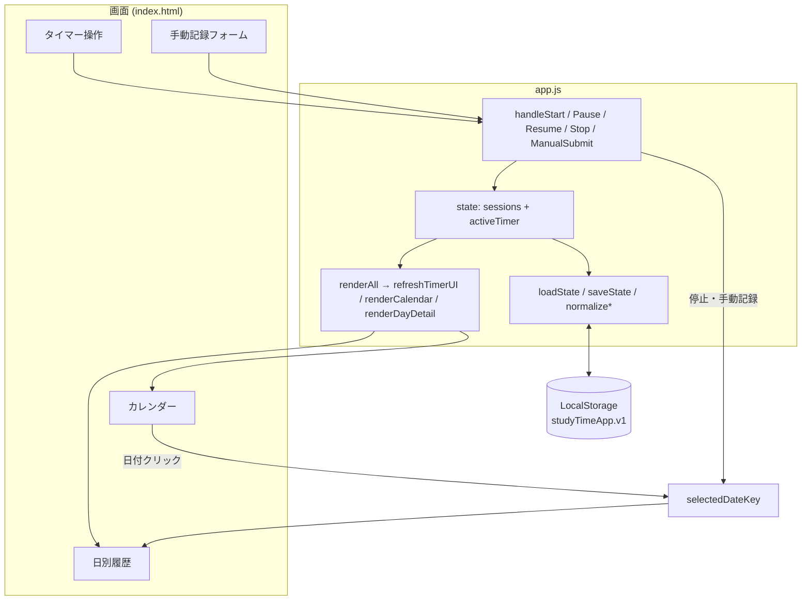
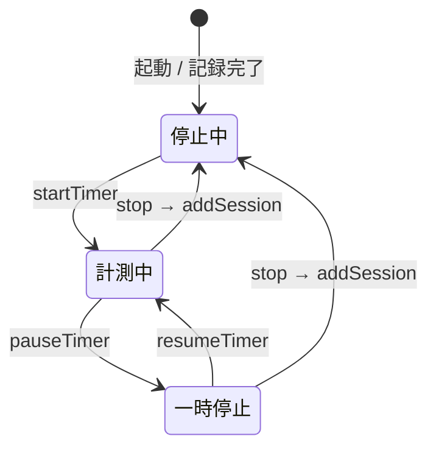

# 勉強時間トラッカー

HTML・CSS・JavaScript で動く、勉強時間を計測・記録し、カレンダーと日別履歴で振り返る Web アプリです。初学者向けに、処理の流れが追いやすいコード構成になっています。

## プロジェクト概要

| 項目 | 内容 |
|------|------|
| 目的 | タイマーで勉強時間を計測し、LocalStorage に保存してカレンダー・履歴で確認する |
| 対象ファイル | ルートの `index.html` / `app.js` / `styles.css` |
| データ保存 | ブラウザの LocalStorage（キー: `studyTimeApp.v1`） |
| 関連（別アプリ） | `todo-app/` は ToDo リストの練習用ミニアプリで、本アプリとは連携しません |

## 機能

| 機能 | 説明 |
|------|------|
| **タイマー** | 開始・一時停止・再開・停止で勉強時間を計測。科目・トピック・メモを紐づけて記録 |
| **LocalStorage 永続化** | 完了したセッションと計測中タイマーをブラウザに自動保存・復元 |
| **カレンダー** | 月間グリッドで勉強した日をハイライト。日付クリックで詳細表示に切り替え |
| **学習履歴（日別）** | 選択日の合計時間とセッション一覧（タイマー / 手動の区別付き） |
| **手動記録** | 日付と分数を指定して、タイマーを使わずにセッションを追加 |

## ファイル構成

```
learn-cursor/
├── index.html      # 画面構造（タイマー・カレンダー・日別履歴・手動記録フォーム）
├── app.js          # タイマー・保存・カレンダー・履歴のすべてのロジック
├── styles.css      # レイアウトと見た目
├── AGENTS.md       # コーディング方針（初学者向け・読みやすさ重視）
└── todo-app/       # 別課題（本アプリとは無関係）
```

### 操作対象の主な HTML 要素（id）

| id | 役割 |
|----|------|
| `timerDisplay` | 経過時間の表示（HH:MM:SS） |
| `timerStatus` | 停止中 / 計測中 / 一時停止中 |
| `startBtn` / `pauseBtn` / `resumeBtn` / `stopBtn` | タイマー操作 |
| `subjectInput` / `topicInput` / `notesInput` | 科目・トピック・メモ |
| `manualForm` / `manualDateInput` / `manualMinutesInput` | 手動記録 |
| `calendarGrid` / `calendarMonthLabel` / `prevMonthBtn` / `nextMonthBtn` | 月間カレンダー |
| `dayDetailDate` / `dayDetailTotal` / `sessionList` / `emptyDayMessage` | 日別の勉強履歴 |

## 使い方（ローカルで動かす）

1. このフォルダの `index.html` をブラウザで開く（ダブルクリック、または Live Server 等でも可）
2. 科目・トピック・メモを入力し「開始」で計測
3. 「停止して記録」でその日のセッションとして保存
4. カレンダーの日付をクリックすると、右側にその日の履歴が表示される
5. 「手動で記録」から、過去日付・分数を指定して記録することもできる

データは同じブラウザの LocalStorage に残ります。別ブラウザやシークレットモードでは共有されません。

---

## サブシステム別の処理概要

### 1. タイマー処理

**状態:** `state.activeTimer`（計測中のみ存在。停止後は `null`）

**コア関数:**

| 関数 | 役割 |
|------|------|
| `startTimer` | 計測開始。`startedAt`・科目情報・`accumulatedMs: 0` を持つオブジェクトを作る |
| `pauseTimer` | `getElapsedMs` で経過を `accumulatedMs` に加算し、`pausedAt` を設定。`startedAt` を null にする |
| `resumeTimer` | 新しい `startedAt` を設定し、`pausedAt` を解除 |
| `getElapsedMs` | `accumulatedMs` +（実行中なら）現在セグメントの経過ミリ秒 |
| `buildSessionFromTimer` | 停止時に `sessions` 用の1件オブジェクトを生成（`source: 'timer'`） |

**UI 更新の流れ:**

1. ボタン操作 → `handleStart` / `handlePause` / `handleResume` / `handleStop`
2. `state` を更新 → `persist()` で LocalStorage へ保存
3. `renderAll()` → `refreshTimerUI()` で表示・ボタン有効/無効・1秒ごとの `setInterval` を制御

計測中は科目・トピック・メモの入力欄を無効化し、開始済みの内容を固定します。タブを再度表示したときは `visibilitychange` で表示だけ再計算します（バックグラウンド中の経過は `Date.now()` ベースで正しく積算されます）。

**停止時の特例:** 1秒未満の記録は確認ダイアログで破棄可能。破棄時はセッションを追加せず `activeTimer` だけクリアします。

### 2. LocalStorage 保存処理

**キー:** `studyTimeApp.v1`

**保存形式（JSON）:**

```json
{
  "version": 1,
  "sessions": [ /* 完了した勉強記録の配列 */ ],
  "activeTimer": null /* または計測中オブジェクト */
}
```

| 関数 | 役割 |
|------|------|
| `loadState` | 起動時に読み込み。パース失敗・不正データは `DEFAULT_STATE` にフォールバック |
| `saveState` | `sessions` と `activeTimer` を JSON 化して保存 |
| `persist` | 現在の `state` を `saveState` に渡す薄いラッパー |
| `normalizeSession` / `normalizeActiveTimer` | 読み込み時に型・日付形式・数値を検証・補正 |
| `addSession` | 正規化したうえで `sessions` 配列に追加 |
| `setActiveTimer` | `activeTimer` の差し替え（イミュータブルに `state` を返す） |

**保存タイミング:** タイマーの開始・一時停止・再開・停止、手動記録の送信のたびに `persist()` が呼ばれます。

**永続化されないもの:** カレンダーで表示している年・月（`calendarYear` / `calendarMonth`）、選択中の日付（`selectedDateKey`）はメモリ上のみ。再読み込み後は「今日」が選択され、カレンダーは当月から表示されます（手動記録でその月へジャンプする場合を除く）。

### 3. カレンダー表示処理

**表示状態（メモリ）:** `calendarYear`, `calendarMonth`, `selectedDateKey`

| 関数 | 役割 |
|------|------|
| `renderCalendar` | 当月を含む 6 週 × 7 日 = 42 セルのボタンを生成 |
| `getDatesWithSessions` | `sessions` から勉強記録がある日付キー（`YYYY-MM-DD`）の Set を作る |
| `shiftMonth` | 前月・次月ボタンで年月を変更し、カレンダーのみ再描画 |

**各セルの装飾:**

- 当月外: `calendar-day--muted`
- 記録あり: `calendar-day--has-study`
- 今日: `calendar-day--today`
- 選択中: `calendar-day--selected`

日付クリック → `selectedDateKey` を更新 → `renderCalendar()` と `renderDayDetail()` を再実行。

### 4. 学習履歴（日別）表示処理

| 関数 | 役割 |
|------|------|
| `renderDayDetail` | 選択日の合計時間とセッション一覧を DOM に描画 |
| `getSessionsForDate` | 指定日の `sessions` をフィルタ（`startedAt` でソート） |
| `getTotalMsForDate` | その日の `durationMs` 合計 |

各セッション行には、科目・トピック、時間、出所（タイマー / 手動）、メモを表示します。記録がなければ `emptyDayMessage` を表示します。

**手動記録** (`handleManualSubmit`): 日付・分数・現在の科目フィールドから `source: 'manual'` のセッションを追加し、選択日とカレンダー表示月をその日付に合わせます。

---

## 処理の関係一覧

| # | 処理 | 入力・参照 | 出力・副作用 |
|---|------|------------|--------------|
| 1 | タイマー計測 | ユーザー操作、時刻 | `state.activeTimer` の更新 |
| 2 | 停止・手動記録 | タイマー or フォーム | `state.sessions` への追加 |
| 3 | 永続化 | `state` 全体 | LocalStorage 読み書き |
| 4 | カレンダー | `sessions` の日付集合、選択日 | グリッド UI、選択状態 |
| 5 | 日別履歴 | `selectedDateKey`、`sessions` | 合計・一覧 UI |

**依存関係:** タイマー・手動記録 → (2) が (3) を経由して保存 → (4)(5) は (3) から復元した `sessions` と、メモリ上の `selectedDateKey` を参照して描画。

---

## データフロー（関係図）





---

## セッション1件のデータ例

タイマーで記録した場合:

```javascript
{
  id: "uuid-or-fallback-id",
  date: "2026-05-23",
  subject: "数学",
  topic: "微分積分",
  notes: "演習問題",
  durationMs: 3600000,
  startedAt: "2026-05-23T10:00:00.000Z",
  endedAt: "2026-05-23T11:00:00.000Z",
  source: "timer"
}
```

手動記録の場合は `startedAt` / `endedAt` が `null` になり、`source` は `"manual"` です。

---

## 初期化の流れ

1. `loadState()` で LocalStorage から `state` を構築
2. `restoreActiveTimerFields()` で計測中なら科目フィールドを復元
3. `initManualDateDefault()` で手動記録の日付を今日に設定
4. `renderAll()` でタイマー・カレンダー・日別履歴を一括描画
5. 各ボタン・フォームにイベントリスナーを登録

---

## 分析時の注意点（ caveats ）

1. **ルート README の差し替え:** 以前の README は別課題（パスワードジェネレーター）の説明でした。本ドキュメントは勉強時間トラッカー向けに更新しています。
2. **関数コメント:** ユーザールールでは「関数には必ずコメント」とありますが、現状の `app.js` には関数コメントがありません。初学者向けドキュメントをコード内にも足す場合は、各関数の直上に日本語コメントを追加する必要があります。
3. **デッドコード:** `app.js` 460 行付近の `{ createId };` は実行時に何もしない式文で、意図しない残り物の可能性があります（削除しても動作に影響しない想定）。
4. **カレンダー状態は非永続:** 表示月・選択日はリロードでリセットされます（記録データ自体は残ります）。
5. **日付の基準:** タイマー停止時の `date` は「停止した瞬間のローカル日付」です。深夜跨ぎで計測した場合、開始日と記録日がずれることがあります。
6. **削除・編集 UI なし:** 一度保存したセッションをアプリ上から修正・削除する機能はありません。
7. **`todo-app`:** 同リポジトリ内の別演習であり、勉強時間データとは共有されません。

---

## コーディング規約（このプロジェクト）

- HTML と JavaScript は別ファイル（`index.html` + `app.js`）
- 操作する要素には意味の分かる `id` を付与
- 関数名は処理内容が分かる英語名（`renderCalendar`, `buildSessionFromTimer` など）
- **関数コメント:** プロジェクトルールでは各関数にコメントを付ける想定です。現状の `app.js` にはコメントがなく、役割は本 README の「サブシステム別の処理概要」「主要関数」表で補完しています。コード内にも説明を足す場合は、各関数の直上に日本語で目的を1行書く形式がおすすめです
- `AGENTS.md`: 省略記法を避け、読みやすいコードを優先

---

## リポジトリ内のその他フォルダ

`learn-cursor` には、過去の演習（BMI 計算、ToDo、ダイスなど）が日付付きフォルダや `bmi-calculator/` などとして含まれています。それらはそれぞれ独立した小さなアプリです。勉強時間トラッカーの本体は**リポジトリルート**の 3 ファイルです。
